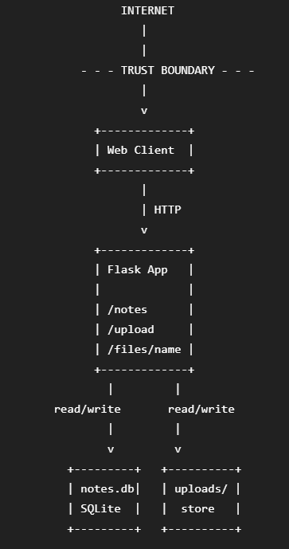

# Threat Model — <app name>

## 1. Data-flow diagram
(Insert your DFD image. Mark trust boundaries with dashed lines.)

## 2. Elements & trust boundaries
Element	Type (process/store/entity/flow)	Trust boundary crossed?
Web client	external entity	Yes (Internet → app)
Flask app	process	Yes (Internet → app)
SQLite DB (notes.db)	data store	Yes (app → data store)
uploads/ store	data store	Yes (app → upload storage)
## 3. STRIDE analysis
Element	S	T	R	I	D	E
/notes	Client can claim another owner because no authentication	Note data can be modified through client input	No request logging	Notes may be exposed to unauthorized users	Excessive requests can consume resources	Unauthorized users may perform actions as another user
/upload	No authenticated uploader identity	User-controlled filename can alter save path	No upload logging	Resolved server save path is disclosed	Large/many uploads can exhaust storage	File-writing capability may be abused
/files/<name>	No strong identity/ownership check	Filename is user-controlled input	No access logging	Could disclose files if path controls fail	Repeated file requests can consume resources	Unauthorized file access may occur if authorization is missing

## 4. Top 5 risks (likelihood × impact) + mitigation
1.Unsafe filename / Path Traversal in /upload
2.Spoofing / Missing authentication in /notes
3.Information Disclosure from /upload
4.Repudiation due to missing logging
5.Denial of Service through unrestricted requests/uploads
