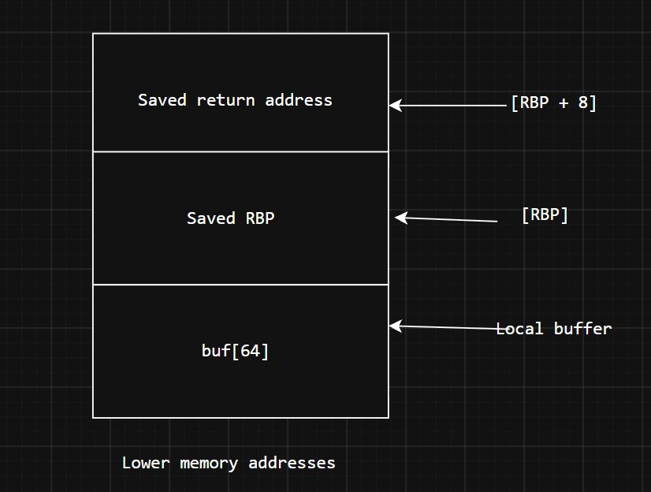
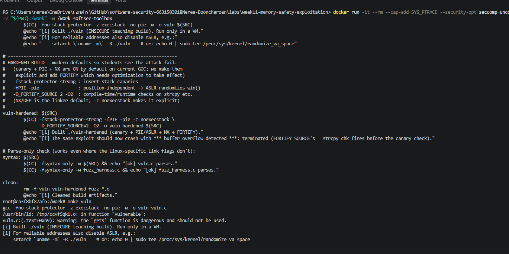
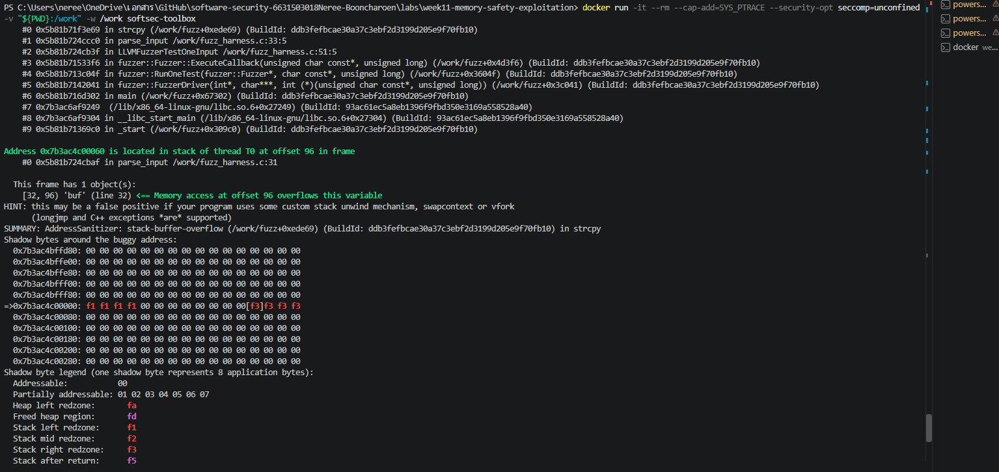
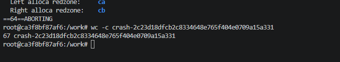
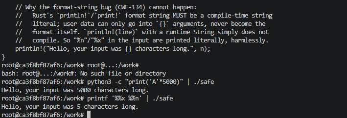
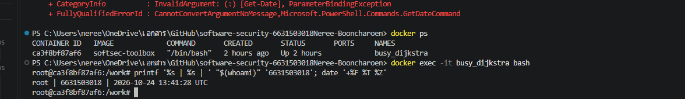

# Worksheet 11 — Memory-Safety & Exploitation (3 hrs)

> **Course:** Software Security (KOSEN69) · Week 11
> **Aligned:** CWE-121 (stack-based buffer overflow) · CWE-787 (out-of-bounds write) · CWE-134 (externally-controlled format string) · CWE-242 (dangerous `gets`)
> **Signature game:** 💥 Fuzzing Race → Pwn the Binary
>
> **Ethics note:** The binaries built from `vuln.c` are **intentionally exploitable** and `win()` spawns `/bin/sh`. Build and run them **only inside the isolated toolbox container** (or a VM) — never on your host. Never run these on a machine you care about, and never aim these techniques at software you are not authorized to test.

## Part 1 — Student Information

| Name | Student ID | Date | Group |
|Neree Booncharoen|6631503018|------|-------|
|      |           |      |       |

## Part 2 — Lecture Questions

1. Draw the x86-64 stack frame for `parse_input()` in `vuln.c` (buf[64], saved RBP, saved return address). Where does `strcpy` start writing and which word must the exploit overwrite?
Answer:strcpy() starts writing at the beginning of buf and copies bytes until it encounters a null terminator. If the input exceeds the buffer capacity, it can overwrite adjacent stack data.

The saved return address is the control-flow-sensitive value that an attacker may attempt to overwrite. The exact offset depends on the compiled program, architecture, and compiler-generated stack layout.
2. Why is `gets()` (CWE-242) impossible to use safely, and why did C11 remove it from the standard library?
Answer:gets() is inherently unsafe because it reads input without accepting a destination-buffer size. It cannot determine whether the input fits in the allocated buffer, potentially causing a buffer overflow.

C11 removed gets() from the standard library because there is no reliable way for the function itself to prevent this problem. Safer alternatives include fgets(), which accepts a maximum number of characters to read.
3. Explain CWE-134: why is `printf(user_input)` dangerous but `printf("%s", user_input)` safe? What can `%n` do?
Answer:printf(user_input) is dangerous because the program treats the user's input as formatting instructions. An attacker may use special format specifiers to access or modify memory.

printf("%s", user_input) is safer because the program treats the input as normal text. The %n specifier can write the number of characters printed so far to a memory location, which can be dangerous if misused.
4. Name the four mitigations in the hardened build (`make vuln-hardened`) — stack canary, PIE/ASLR, NX/DEP, FORTIFY — and say which one each defeats: ret2win, 
Answer:Stack Canary: Detects many attempts to overwrite data on the stack.
PIE/ASLR: Randomizes memory addresses, making it harder to predict where code is located.
NX/DEP: Prevents the program from executing code in memory areas that should only store data.
FORTIFY: Adds checks to help detect unsafe operations that could cause buffer overflows.

5. The CISA/ONCD roadmaps push memory-safe languages. Using `safe.rs`, explain why CWE-121 is *impossible* in safe Rust, not merely harder.
Answer:Safe Rust checks array boundaries before accessing memory. If a program tries to access an invalid index, it stops with a panic instead of allowing an out-of-bounds write. Rust also has ownership and borrowing rules that help prevent memory errors.

Therefore, safe Rust prevents this type of buffer overflow without relying only on security protections added by the compiler.

## Part 3 — Hands-on Lab (145 min)


**Learning goals:** Find the overflow with a coverage-guided fuzzer, exploit it (ret2win), watch mitigations break the exploit, then port the routine to safe Rust.

**Prerequisites:** the **toolbox container** (bundles `clang`+libFuzzer, `gdb`, `objdump`, `python3`) — Apple clang has no libFuzzer and `gdb` is painful on macOS, so do this week in the container. (`pip install pwntools` and `rustc` inside as needed; an isolated Linux VM also works.)

**Environment setup**
```bash
# from the repo root, build the toolbox once, then open a shell IN this week's folder:
docker build -t softsec-toolbox labs/toolbox
docker run -it --rm --cap-add=SYS_PTRACE --security-opt seccomp=unconfined \
    -v "$PWD/labs/week11-memory-safety-exploitation":/work -w /work softsec-toolbox
# --- inside the container ---
make vuln                                          # teaching build: mitigations OFF
make vuln-hardened                                 # mitigations ON
clang -g -fsanitize=address,fuzzer fuzz_harness.c -o fuzz   # libFuzzer + ASan
setarch `uname -m` -R ./vuln                       # disable ASLR for repeatable addresses
```

**What to submit per task:** the exact command(s) + crash/exploit output, a screenshot, and a 2–3 sentence mitigation note tied to the CWE.

### Task 0 — Onboarding (15 min)
Run `make syntax` (parses both C files even on macOS) and confirm `make vuln` / `make vuln-hardened` build. Read the bug-class banner in `vuln.c`.
**Deliverable:** build output + the list of CWEs `vuln.c` claims to demonstrate.


### Task 1 — Fuzzing Race: find the crash (35 min)
**Goal:** Make libFuzzer + AddressSanitizer crash on the `strcpy` overflow in `parse_input()` — CWE-121/787.
**Steps:**
1. `./fuzz -runs=100000` (or just `./fuzz`).
Answer:AddressSanitizer detected a stack-buffer-overflow in parse_input() at fuzz_harness.c:33. The error occurred in strcpy() because the input exceeded the destination buffer's boundary. Replaying the saved crash file reproduced the error.
2. Read the ASan report — note `stack-buffer-overflow` inside `parse_input` and the saved `crash-<hash>` file.
Answer:The crashing input file was crash-2c23d18dfcb2c8334648e765f404e0709a15a331.
The file size was 67 bytes, as confirmed by the wc -c command.

Input length: [Enter the number of bytes reported by wc -c].
3. Replay it: `./fuzz crash-<hash>`.
**Deliverable:** the ASan crash summary + the byte length of the crashing input + mitigation note.
Answer:To prevent this vulnerability, check the input length before copying, use safer input-handling methods, and ensure the destination buffer has enough space for the input and the null terminator. Avoid using strcpy() when the input length is not guaranteed. 
### Task 2 — Pwn the Binary: ret2win (40 min)
**Goal:** Overwrite the saved return address so the binary returns into `win()` and prints `FLAG{stack_smashing_for_fun_and_education}` — CWE-121.
**Steps:**
1. Find `win()`'s address: `objdump -d vuln | grep '<win>:'` (or `gdb -batch -ex 'p win' ./vuln`).
Answer:The parse_input() function contains a 64-byte buffer named buf. It uses strcpy() without checking the input length. If the input is too long, it can overwrite adjacent stack data, including the saved RBP and potentially the saved return address.
2. Verify the offset with a cyclic pattern (do **not** trust 72 blindly): feed `cyclic(200)`, crash in gdb, `cyclic_find` the value in RIP. (On an Apple Silicon/arm64 Mac the toolbox has no platform pin, so it builds as an **aarch64** container — there is no `RIP`; use `info registers pc` / `p/x $pc` instead, and expect `SIGBUS`, not `SIGSEGV`. The offset itself is still 72 here.)
Answer:The win() function prints a message indicating that control flow reached the function and displays the lab flag.
3. Edit `exploit_skeleton.py`: set `WIN_ADDR` to the address from step 1, confirm `OFFSET`.
Answer:The source comment suggests 72 bytes on a typical build (64 bytes for the buffer plus 8 bytes for saved RBP). This value must be verified for the actual compiled binary.
4. `python3 exploit_skeleton.py` (pwntools path) — or `python3 exploit_skeleton.py | ./vuln`. (On arm64: the flag still prints, but the process then loops forever re-printing `[+] win() reached` instead of exiting — ARM64 keeps the return address in register `x30`, which still holds `win()`'s own address when it starts, so `win()`'s `ret` returns into itself. Expected; `Ctrl-C` once you've captured the flag.)
Answer:The normal build disables some protections for teaching purposes. The hardened build enables stack canaries, PIE/ASLR, NX, and FORTIFY. These protections help detect stack corruption, randomize addresses, prevent execution of stack data, and check certain unsafe memory operations.
**Deliverable:** the verified `OFFSET`, your `WIN_ADDR`, and the printed flag / `[+] win() reached` line.

### Task 3 — Hardened rebuild: watch the exploit break (25 min)

```sim
stack-frame
```

**Goal:** Observe modern mitigations defeating the same payload.
**Steps:**
1. Run your Task 2 payload against `./vuln-hardened`.
Answer:The vuln-hardened program was built successfully with stack canaries, PIE/ASLR, NX, and FORTIFY enabled. The runtime test is needed to observe how the original payload behaves against the hardened binary.
2. Record the failure mode: `*** buffer overflow detected ***: terminated` (FORTIFY_SOURCE's `__strcpy_chk`, which on this build catches the overflow before the stack canary's epilogue check ever runs), or a SIGSEGV at a randomized address (PIE/ASLR makes `WIN_ADDR` wrong).
Answer:Failure mode: The expected error is *** buffer overflow detected ***: terminated.

Explanation: FORTIFY detects that strcpy() is copying more data than the destination buffer can hold. It terminates the program before the stack canary check runs. PIE/ASLR also randomizes program addresses, so a fixed WIN_ADDR from the non-PIE build may no longer point to win().

The actual failure message must be confirmed from the runtime test.
**Deliverable:** the crash message + a note explaining *which* mitigation fired and why the fixed `WIN_ADDR` no longer works.

### Task 4 — Rust rewrite: defend / fix it (30 min)
**Goal:** Show the bug class disappears in safe Rust using `safe.rs`.
**Steps:**
1. `rustc safe.rs && ./safe`, then `python3 -c "print('A'*5000)" | ./safe` — note it never overflows or crashes.
Answer:
2. Feed format-string metacharacters: `printf '%%x %%n' | ./safe` — note the program just reports the character count with no crash and no stack leak; the input is treated as ordinary data (CWE-134 impossible: `println!`'s format string must be a compile-time literal, so `println!(line)` would not even compile).
Answer:The program processed %x %n and printed Hello, your input was 5 characters long. The input was treated as ordinary text.
3. From the inline comments, write *why* `String`/`&str` + bounds checks make CWE-121/787 impossible.
Answer:Rust uses a growable String to store input instead of copying it into a fixed-size buffer. Safe Rust prevents out-of-bounds memory writes, eliminating CWE-121 and CWE-787 in safe code. Rust's println! macro requires a compile-time format string, preventing user input from being interpreted as format directives. This supports the CISA memory-safe roadmap, which encourages the adoption of memory-safe languages to reduce memory-safety vulnerabilities.
**Deliverable:** the safe output for both inputs + a 3–4 sentence explanation tying it to the CISA memory-safe roadmap.

## Part 4 — Reflection

1. **Mapping:** table — bug | function in `vuln.c` | CWE | mitigation that stops it (canary / PIE / NX / Rust).
Answer:Bug/	Function in vuln.c/	CWE	/Mitigation
Stack buffer overflow	parse_input() using strcpy()	CWE-121 / CWE-787	Rust safe code prevents out-of-bounds writes; canary helps detect stack corruption
Unsafe input	gets() in vulnerable()	CWE-242	Replace with bounded input functions
Format string	printf(user_input)	CWE-134	Use printf("%s", user_input) or Rust formatting
Executing code from stack	Overflow-related attack	CWE-121	NX prevents executing code on the stack
Fixed function address	Returning to win()	CWE-121	PIE/ASLR makes addresses unpredictable
2. **Real breach:** pick a memory-safety incident (Morris Worm fingerd overflow, or Heartbleed CVE-2014-0160). Which CWE applies, and would a stack canary or a Rust rewrite have prevented it?
Answer:Heartbleed (CVE-2014-0160) was a bug in OpenSSL that allowed attackers to read data from memory.
- CWE: CWE-125 (Out-of-bounds Read).
- Stack canary: Would not prevent it because the bug reads memory instead of overwriting it.
- Rust: Safe Rust could prevent this type of memory-reading bug.
3. **Best mitigation:** compare "harden the C build" vs. "rewrite in Rust." Which gives durable risk reduction for new code, and what is the cost?
Answer:Hardened C: Adds protection such as stack canaries, PIE/ASLR, and NX, but some bugs can still happen.
Rust: Prevents many memory errors automatically, but developers still need to write and check code carefully.
Conclusion: Rust is generally safer for new projects. Hardened C is useful for protecting existing C programs.
## Grading rubric (100)

| Criterion | Weight |
|-----------|--------|
| Lecture questions (Part 2) | 20 |
| Exploitation + evidence (Tasks 1–3: fuzz crash, ret2win flag, hardened break) | 40 |
| Defense (Task 4: Rust rewrite + explanation) | 25 |
| Reflection (Part 4: mapping, breach, best mitigation) | 15 |
| **Total** | **100** |

---

## Evidence & Integrity (required)

- **Identity proof:** every screenshot/diagram must show a terminal running `printf '%s | %s | ' "$(whoami)" '<YOUR-STUDENT-ID>'; date '+%F %T %Z'` **in the
  same image as the evidence**. When the evidence is a browser page, a DevTools panel or a
  rendered response, put that terminal **beside the browser and capture the whole screen** — a
  cropped window carries nothing that identifies you, and the lab's own output is
  byte-identical for the whole cohort *by design*, so the stamp is the only thing that makes
  the shot yours. Generic or borrowed evidence is not accepted.
- **Personalized flag (if this lab issues one):** ____________________
  *Flags are unique per student — submitting another student's flag is a violation. How to submit: **learn.zcr.ai/submit** (full guide: `SUBMISSION.md` in the repo root).*
- **Explain in your own words** *(graded on your reasoning, not copied text):*
  1. What did you do, and **why did the vulnerability work**?
   I tested the vulnerable program with a long input. The vulnerability worked because the program did not check the input size, causing a buffer overflow.

  2. **Why does your fix actually stop it** — and what could still break it?
  The fix prevents writing outside the buffer by checking input safely. However, other bugs may still exist, so the program must be tested carefully.

---

## 🤖 Audit the AI (required)

AI is a power tool you must **distrust** — you are graded on your *critique*, not the AI's answer.

1. Ask an AI assistant to exploit **or** fix this week's vulnerability. Paste its full answer.
Answer:The vulnerable program uses strcpy() to copy user input into a fixed-size buffer without checking the input length. This can cause a stack buffer overflow and may corrupt nearby memory.

A fix is to use a bounded input function, validate the input length, and avoid unsafe memory operations. Compiler protections such as stack canaries, PIE/ASLR, NX, and FORTIFY_SOURCE can reduce the risk of exploitation. Rust can also prevent many memory-safety errors when safe Rust is used correctly.
2. **Find what's wrong or risky** in it — insecure code, a subtly incomplete fix, a hallucinated API/function/CVE, a missed edge case, or wrong reasoning. Quote the exact line(s).
Answer:Problem 1: The AI says to use a bounded input function but does not provide the exact implementation. Developers might choose an incorrect buffer size or forget to check whether the input was truncated.

Problem 2: The AI lists compiler protections but does not explain that they do not fix the underlying vulnerability. These protections reduce some exploitation risks, but the program can still contain memory-safety bugs.

Problem 3: The AI says Rust can prevent many memory-safety errors, but this does not apply automatically to code using unsafe blocks or unsafe external libraries.
3. Produce the **correct, verified** version yourself and explain in 2–3 sentences why the AI's output was insufficient.
Answer:This version uses fgets() to limit input to the size of the buffer and uses printf("%s", ...) style formatting instead of treating user input as a format string. However, input longer than the buffer may be truncated, so the application should detect and handle incomplete input when the full input is required. These changes reduce the identified risks, but they do not prove that the entire program is secure.
> Disclose your AI use in the Part 1 table. This task counts toward your **Defense + Reflection** score.

---

## 🧠 Comprehension & Prompt (required)

**A. Explain in Plain English (EiPE).** In 2–3 sentences, in your 
Answer:The program copies user input into a small buffer without checking its size. If the input is too long, it can overwrite nearby memory and cause the program to crash or behave unexpectedly.
**B. Prompt Problem.** Write a **single prompt** that makes an AI produce a *correct, secure* fix for one finding. Run it: does the exploit now fail? If not, refine the prompt and try again. Submit the **final prompt + the verified result**.
Answer:Review the provided vuln.c code and fix the stack buffer overflow in parse_input(). The function currently copies user-controlled input into a fixed-size buffer using strcpy(). Replace this with a safe implementation that prevents writing beyond the buffer, handles overly long input correctly, and preserves the intended program behavior. Do not merely add compiler protections or hide the warning. Show the complete corrected function, explain the changes, and provide tests for normal input, empty input, and input longer than the buffer. Clearly distinguish tests you have actually run from tests you recommend running.
*Graded on the prompt's precision and your verification — this trains problem decomposition and AI literacy (Denny et al. 2024).*
